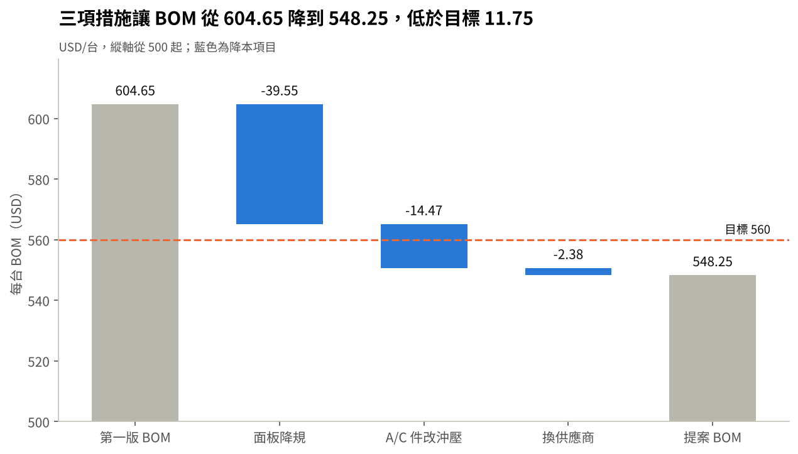
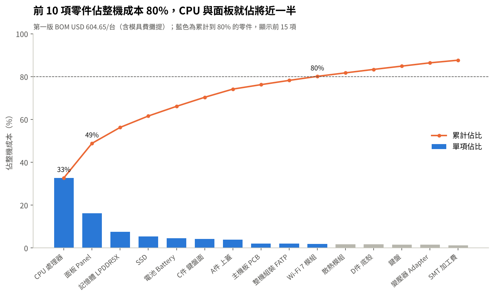
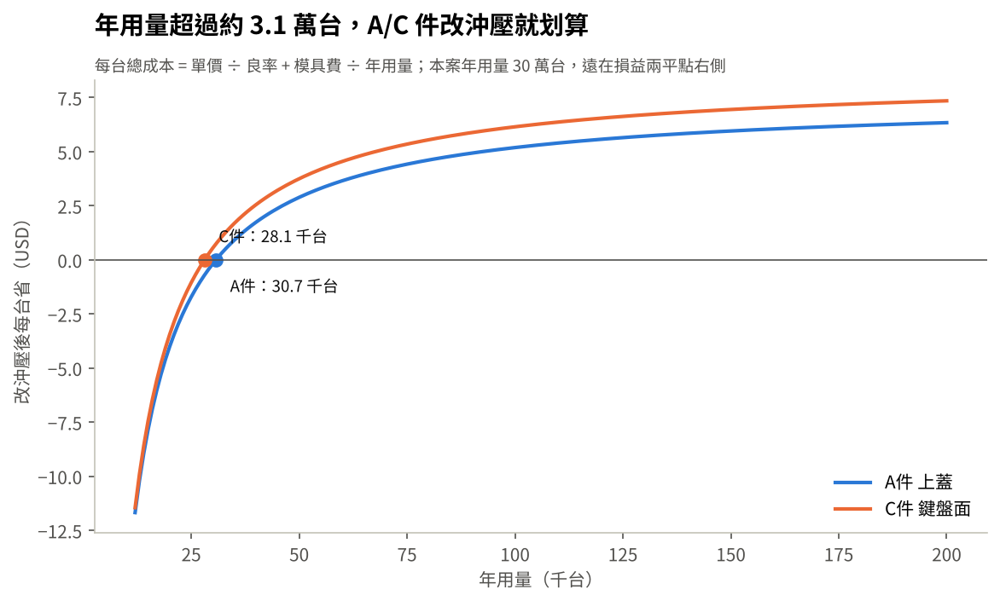
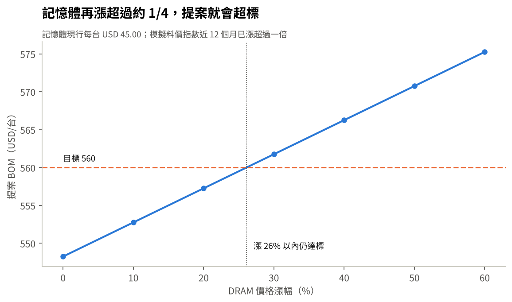

# 筆電 BOM 降本分析：USD 604 → 548

> 一台 14 吋商務筆電，客戶要求 BOM 成本壓在每台 USD 560。第一版報價超標約 8%。
> 這個專案從資料清洗、Pareto 分析、供應商比價、機構材質比較，一路做到一份達標的降本提案。

**結論：** 面板降規、A/C 件改沖壓、換已驗證供應商，三項措施合計每台省 **USD 56.40**，BOM 從 604.65 降到 **548.25**，比目標低 11.75，以年用量 30 萬台計，一年省約 **USD 1,692 萬**。如果客戶堅持保留 OLED 面板，就算所有高風險方案都用上，也只能降到 563，無法達標。



*資料為模擬資料。除晶片與面板原廠品牌外，公司名稱皆為虛構；價格不代表真實行情。*

---

## 題目

| 項目 | 內容 |
| --- | --- |
| 產品 | NB-14P 14 吋輕薄商務筆電 |
| 年用量 | 300,000 台，生命週期 18 個月 |
| 客戶目標 | BOM USD 560/台 |
| 第一版報價 | USD 604.65/台（含模具費攤提與組裝） |
| 資料 | 40 項主要零件、20 家供應商、71 筆報價、12 個機殼方案、3 個散熱方案、10 個 EE 方案、22 個月料價指數 |

整台筆電有上千個料，這裡只列 40 項**主要成本零件**（EE 主機板、EE 系統件、ME 機構件、組裝），小零件合併成一行計價。

## 分析流程

### 1. 資料清洗：先找出報價裡的錯誤

真實的報價資料一定會有錯，直接比價會選錯供應商。這份資料裡找到 3 筆：

| 報價 | 問題 | 處理 |
| --- | --- | --- |
| Q0004 記憶體 | 單價是「每 GB」，不是每顆 | 換算成每顆（×4） |
| Q0039 面板 | 報價含 5% 營業稅 | 換算成未稅價 |
| Q0056 A 件 | 模具費 13,600，其他家約 15 萬 | 判斷少打一個 0，待供應商確認 |

第 3 筆如果沒抓到，A 件會多算出每台約 0.41 美元的「假省額」。

### 2. Pareto 分析：成本集中在哪裡



前 10 項零件佔整機成本 80%，CPU 和面板兩項就佔 49%。CPU 是原廠單一來源，價格很難談，所以降本重點放在**面板**和**機殼**。

### 3. 供應商重選：只靠議價不夠

每個零件改選最划算的報價（模具費攤到 30 萬台），每台最多省 12.23 美元，但其中 2.54 美元來自五金廠跨業報的鍵盤、轉軸、喇叭，還沒通過樣品驗證。只算已驗證的供應商，每台省 9.69 美元，離目標還差 30 幾美元。

**結論：光換供應商不夠，一定要動到規格或設計。**

### 4. 機殼材質：把模具費和良率算進去

每台總成本 = 單價 ÷ 良率 + 模具費 ÷ 年用量

| 每台總成本（USD） | A 件 上蓋 | C 件 鍵盤面 | D 件 底殼 |
| --- | --- | --- | --- |
| 鋁 CNC | 23.42（現行） | 27.97（現行） | 19.22 |
| 鋁沖壓 + 局部 CNC | **16.69** | **20.22** | **10.31**（現行） |
| 鎂鋁合金壓鑄 | 15.14 | 17.95 | 11.06 |
| PC/ABS 塑膠 | 6.92 | 8.60 | 5.00 |

塑膠最便宜，但商務機 A/C 件用塑膠，客戶接受度低。規格書寫明 A/C/D 件用鋁合金，所以**沖壓是唯一在規格內、不需要客戶同意的方案**。

D 件的鎂鋁壓鑄單價比沖壓便宜，但良率只有 88%、模具費高，算下來反而貴 0.75，這是「只看單價」會做錯的例子。



沖壓模具比 CNC 治具多付約 23～24 萬美元，但年用量只要超過約 3.1 萬台就回本。本案 30 萬台，遠在損益兩平點右側。

### 5. 降本提案

| # | 領域 | 措施 | 每台省 USD | 年省 USD |
| --- | --- | --- | --- | --- |
| 1 | EE | 面板 2.8K OLED → 2.2K IPS 90Hz | 39.55 | 1,187 萬 |
| 2 | ME | A/C 件鋁 CNC → 鋁沖壓 + 局部 CNC | 14.47 | 434 萬 |
| 3 | EE | 換已驗證供應商（記憶體、Wi-Fi、Retimer 等 6 項） | 2.38 | 71 萬 |
| | | **合計** | **56.40** | **1,692 萬** |

**避免重複計算：** 面板改規格後，「換 BOE OLED」省的 6.01 就不再計入；A 件改沖壓後，「換豐岳 CNC」省的 1.30 也不再計入。

### 6. 風險：DRAM 漲價



提案有 11.75 美元的安全邊際，DRAM 再漲 26% 以內仍可達標。但料價指數近一年已經漲了一倍多，建議先和 Micron 談 1～2 季的長約鎖價。

### 7. 備案：客戶堅持保留 OLED

| 步驟 | 措施 | 每台省 | 累計 BOM | 主要風險 |
| --- | --- | --- | --- | --- |
| 起點 | 面板換 BOE OLED + A/C 件沖壓 + 換已驗證供應商 | 22.86 | 581.79 | |
| 1 | A/C 件改鎂鋁壓鑄 | 3.83 | 577.97 | 良率 86～88%、開模 12 週 |
| 2 | D 件改 PC/ABS 塑膠 | 5.31 | 572.66 | 不符合鋁合金規格 |
| 3 | 散熱改單風扇 + 單熱管 | 4.07 | 568.59 | CPU 降到 20W，效能約 -12% |
| 4 | 鍵盤、轉軸、喇叭改五金廠 | 2.54 | 566.05 | 跨業報價，需驗證 |
| 5 | PCB 改 8 層通孔板 | 2.98 | 563.07 | 板面積 +22% |

五項中高風險措施全部用上，仍然超標約 3 美元。所以建議把產品拆成兩個 SKU：**IPS 為主力機種，OLED 為高階版另外加價**。

## 假設與限制

- 單價以第一季報價計算，未納入季降幅，所以實際省額可能更多
- 機殼方案的單價是工程估算；若是供應商的正式報價，良率損失通常已含在報價裡，就不需要再除以良率
- 面板降規、換供應商需要客戶核可（AVL），本提案未包含驗證時程與費用
- 報告 PDF（`report/`）的初版以 USD 602 為基準，當時沒有把模具費攤提算進去；本頁修正為 604.65，結論不變

## 專案結構

```
├── data/                  模擬資料（CSV 與 Excel）
├── src/
│   ├── generate_data.py   產生模擬資料（固定亂數種子，可重現）
│   └── analysis.py        重現本頁所有數字與圖表
├── results/               每一步分析的結果表（CSV）
├── images/                圖表
└── report/                降本提案報告（PDF）
```

## 如何執行

```bash
pip install -r requirements.txt
python src/generate_data.py   # 產生 data/
python src/analysis.py        # 產生 results/ 與 images/
```

## 使用技能

- **成本分析：** BOM 成本拆解、Pareto 分析、總持有成本（模具攤提、良率）、損益兩平、敏感度分析、成本橋
- **採購實務：** 多供應商比價、資料清洗（單位、稅金、誤植）、單一來源與驗證風險、長約鎖價
- **工具：** Python（pandas、matplotlib）、Excel

---

## English Summary

A cost-down analysis for a simulated 14" business laptop (300k units/year). The customer's BOM target was USD 560/unit; the first quote came in at USD 604.65. After cleaning three quote errors (unit, tax, and a tooling-fee typo), I ran a Pareto analysis, a supplier re-selection, and a total-cost-of-ownership comparison of four enclosure processes including tooling amortization, yield loss, and break-even volume. The final proposal, a panel downgrade plus switching the A/C covers from CNC to stamping plus switching to qualified alternate suppliers, cuts USD 56.40/unit (≈ USD 16.9M/year) to reach USD 548.25. It also shows that keeping the OLED panel cannot hit the target even with every high-risk option. All data is simulated.
